  <picture>
    <source media="(prefers-color-scheme: dark)" srcset="assets/wr-banner-dark.svg">
    
  </picture>

    

  

<picture>
  <source media="(prefers-color-scheme: dark)" srcset="https://raw.githubusercontent.com/vviktooor/vviktooor/output/activity-dark.svg">
  
</picture>

<picture>
  <source media="(prefers-color-scheme: dark)" srcset="https://raw.githubusercontent.com/vviktooor/vviktooor/output/languages-dark.svg">
  
</picture>

<picture>
  <source media="(prefers-color-scheme: dark)" srcset="https://raw.githubusercontent.com/vviktooor/vviktooor/output/snake-dark.svg">
  
</picture>

---

   
  by WR · Digital · Software · Engineering

